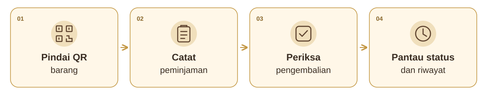

<p align="center">
  
</p>

<h1 align="center">Pindai.in</h1>

<p align="center">
  <strong>Pindai barangnya. Catat peminjamannya. Pantau inventarisnya.</strong>
</p>

<p align="center">
  <a href="https://codeigniter.com/"></a>
  <a href="https://www.php.net/"></a>
  <a href="https://www.mysql.com/"></a>
  <a href="LICENSE"></a>
  <a href="https://github.com/diatyo/pindai-in/releases"></a>
</p>

<p align="center">
  <a href="https://github.com/diatyo/pindai-in/releases"><strong>Unduh installer</strong></a>
  &nbsp;·&nbsp; <a href="#fitur-utama">Fitur utama</a>
  &nbsp;·&nbsp; <a href="#alur-penggunaan">Alur penggunaan</a>
  &nbsp;·&nbsp; <a href="#mulai-menggunakan">Panduan instalasi</a>
  &nbsp;·&nbsp; <a href="CONTRIBUTORS.md">Kontributor</a>
</p>

---

**Pindai.in** merupakan sistem informasi peminjaman dan monitoring inventaris barang
berbasis web dengan identifikasi QR Code. Aplikasi ini dikembangkan di
**SMP Negeri 1 Tanjungpinang** untuk membantu petugas melayani peminjaman sekaligus
menelusuri kondisi, kelengkapan, dan riwayat setiap unit barang.

> **Fokusnya adalah setiap unit fisik.** Dua barang dengan jenis yang sama tetap
> memiliki identitas QR dan riwayat masing-masing, sehingga petugas dapat
> mengetahui unit mana yang tersedia, dipinjam, atau perlu ditindaklanjuti.

## Mengapa Pindai.in?

| Kebutuhan sekolah | Cara Pindai.in membantu |
|---|---|
| Menemukan identitas barang saat melayani peminjaman | Pindai QR pada label untuk membuka informasi unit. |
| Mengetahui siapa yang meminjam dan kapan harus kembali | Catat guru/siswa, keperluan, lokasi penggunaan, serta batas pengembalian. |
| Memastikan barang pendamping ikut kembali | Periksa checklist kelengkapan saat serah terima dan pengembalian. |
| Menindaklanjuti barang yang belum siap digunakan | Pantau keterlambatan, kekurangan kelengkapan, kerusakan, dan penanganannya. |
| Menelusuri perubahan dan menyusun laporan | Gunakan riwayat unit, log aktivitas, dan laporan PDF dengan kop sekolah. |

## Alur penggunaan



Petugas memilih guru atau siswa, mengisi detail peminjaman, lalu memeriksa
kelengkapan yang diserahkan. Saat barang kembali, kondisi dan kelengkapannya
kembali diperiksa. Status serta riwayat unit mengikuti hasil transaksi.

<details>
<summary><strong>Contoh sederhana: peminjaman proyektor</strong></summary>

1. Petugas memindai QR pada proyektor yang akan dipinjam.
2. Petugas memilih peminjam, mencatat keperluan dan rencana kembali, lalu menandai kabel daya dan remote yang ikut diserahkan.
3. Ketika dikembalikan, petugas memeriksa proyektor beserta kelengkapannya.
4. Jika kelengkapan yang ditandai wajib belum kembali, kekurangannya tercatat untuk ditindaklanjuti dan unit belum siap dipinjam lagi.

Contoh ini menggunakan skenario ilustrasi, tanpa data peminjam sekolah.

</details>

## Fitur utama

| Fitur | Yang dapat dilakukan |
|---|---|
| **🏷️ Identitas dan QR per unit** | Catat nama, merek/model, nomor seri, lokasi, kondisi, foto, serta cetak label QR dengan nama barang yang jelas. |
| **📱 Layanan dari perangkat petugas** | Gunakan tampilan responsif pada komputer, tablet, atau HP; pindai QR melalui kamera pada lingkungan yang mendukung. |
| **📦 Peminjaman satu atau beberapa unit** | Catat satu unit atau kelompok unit untuk peminjam yang sama, termasuk pengembalian unit secara bertahap. |
| **✅ Checklist serah terima** | Kelola kelengkapan bawaan, tambahkan pendamping saat transaksi, dan tindak lanjuti kelengkapan yang belum kembali. |
| **🔧 Kerusakan dan penanganan** | Catat laporan kerusakan, tindakan penanganan, dan perubahan kondisi sebagai bagian dari riwayat barang. |
| **📊 Dasbor dan laporan** | Pantau status barang serta tugas yang perlu ditindaklanjuti; buat laporan PDF dengan logo dan kop sekolah yang ukuran font serta ketebalannya dapat diatur per baris. |
| **🔎 Pencarian dan jejak aktivitas** | Cari barang/transaksi dan telusuri aktivitas pengguna untuk membantu pemeriksaan data. |
| **⚙️ Referensi yang dapat dikelola** | Admin mengatur kategori barang, lokasi penyimpanan, akun, dan data guru/siswa. |
| **👥 Pembuatan akun massal** | Buat akun guru/siswa sesuai filter secara bertahap, pantau progres, jeda/lanjutkan, dan unduh daftar akun baru. Akun yang sudah ada dilewati. |

Fitur di atas mengikuti source pada branch `main`. Source dapat memuat pembaruan
yang belum masuk ke installer pada halaman Releases.

## Pengguna dan perannya

| Peran | Fokus penggunaan |
|---|---|
| **Admin** | Mengelola akun, data guru/siswa, referensi, identitas sekolah, dan konfigurasi laporan. |
| **Petugas pengurus barang** | Mengelola unit, memindai QR, melayani peminjaman/pengembalian, serta mencatat kerusakan dan penanganan. |
| **Kepala sekolah** | Melihat informasi inventaris dan laporan untuk monitoring. |
| **Peminjam — akun opsional** | Melihat informasi peminjaman melalui akun yang diberikan pengelola. |

Guru dan siswa dapat dicatat sebagai peminjam **tanpa harus mempunyai akun login**
ketika pelayanan dilakukan oleh petugas.

## Mulai menggunakan

| Pilihan pemasangan | Panduan |
|---|---|
| **Installer Windows** | [Unduh dari Releases](https://github.com/diatyo/pindai-in/releases) dan ikuti [panduan Windows](docs/INSTALL-WINDOWS.md). Webserver PHP, MySQL, dan Windows Service sudah disertakan; Laragon tidak diperlukan. |
| **Server atau hosting** | Pasang source mengikuti [panduan instalasi dari source](docs/INSTALL-SOURCE.md). |
| **Pengaturan laporan sekolah** | Sesuaikan logo daerah/sekolah dan kop melalui [panduan kop PDF](docs/PENGATURAN-KOP-PDF.md). |

Pada instalasi baru, pengguna membuat **identitas sekolah dan akun admin sendiri**.
Paket publik tidak membawa database operasional, data guru/siswa, foto barang,
password sekolah, atau sesi pengguna.

### Akses dari HP, tablet, dan komputer

Pindai.in dapat diakses oleh perangkat yang terhubung ke server aplikasi.
Installer Windows secara bawaan menggunakan `127.0.0.1`. Akses dari perangkat
lain melalui LAN/HTTPS atau tunnel HTTPS seperti ngrok memerlukan penyesuaian
konfigurasi server, alamat aplikasi, dan validasi host. Wizard beta belum
mengatur jaringan/tunnel secara otomatis. Kamera pemindai QR memerlukan HTTPS
dan izin kamera dari browser. Lihat rincian pada [panduan Windows](docs/INSTALL-WINDOWS.md).

## Teknologi dan validasi

<details>
<summary><strong>Lihat teknologi yang digunakan</strong></summary>

| Bagian | Teknologi |
|---|---|
| Backend | CodeIgniter **4.7.4**, PHP **8.3+** |
| Database | MySQL **8.4** pada paket Windows |
| Antarmuka | HTML, CSS, dan JavaScript dengan tampilan responsif |
| QR Code | Endroid QR Code, pemindaian kamera dengan dukungan browser dan jsQR |
| Laporan PDF | Dompdf |
| Pengolahan Excel | PhpSpreadsheet |
| Distribusi Windows | Inno Setup dan Windows Service dengan akun LocalService |

Versi dependensi lengkap tercatat pada [composer.lock](composer.lock).

</details>

Rilis **0.9.0-beta.2** telah melalui pengujian unit, instalasi kosong, login,
pratinjau PDF, ikon/manifest, restart, backup saat upgrade, serta Windows Service
beserta pemulihan prosesnya. Bukti pemeriksaan disertakan sebagai
`BUILD-INFO.json`, `SOURCE-AUDIT.json`, dan `SHA256SUMS.txt` pada
[halaman rilis](https://github.com/diatyo/pindai-in/releases/tag/v0.9.0-beta.2).

Installer masih berstatus **beta** dan belum ditandatangani sertifikat penerbit.
Sebelum pembaruan produksi, cadangkan database dan foto, lalu uji menggunakan
salinan data.

<details>
<summary><strong>Informasi untuk pengembang</strong></summary>

Siapkan lingkungan dan database pengembangan sesuai
[panduan source](docs/INSTALL-SOURCE.md), lalu pasang dependensi dengan Composer.
Pengujian unit dapat dijalankan dengan:

```sh
php vendor/bin/phpunit --bootstrap vendor/codeigniter4/framework/system/Test/bootstrap.php --no-coverage tests/unit
```

Jangan mengarahkan tes integrasi ke database operasional. Seeder demo lama telah
dinonaktifkan. Gunakan `php spark install:initialize` untuk menyiapkan admin
pertama pada database kosong sesuai panduan.

| Folder | Isi |
|---|---|
| `app` | Kode aplikasi, tampilan, dan migrasi |
| `public` | Document root dan aset antarmuka |
| `writable` | Penyimpanan runtime; isinya tidak disertakan dalam source publik |
| `tests` | Pengujian dengan fixture |
| `tools` | Packaging, ekspor source, dan pemeriksaan distribusi |
| `installer/windows` | Source installer dan pengelolaan Windows Service |

Build installer tersedia melalui `tools/build-windows.ps1`. Prosedur pemisahan
source publik dijelaskan di [PUBLIC-SOURCE.md](docs/PUBLIC-SOURCE.md).

</details>

## Pengembang dan atribusi

Dikembangkan di **SMP Negeri 1 Tanjungpinang** oleh **Dimas Adi Prasetyo**,
dengan bantuan **OpenAI Codex** sebagai asisten AI dalam implementasi,
penelusuran masalah, peninjauan UI/UX, pengujian, dokumentasi, dan penyiapan paket distribusi.
Rincian peran tercantum di [CONTRIBUTORS.md](CONTRIBUTORS.md).

## Lisensi dan pelaporan masalah

Source aplikasi mengikuti [lisensi MIT](LICENSE). Komponen pihak ketiga tetap
mengikuti lisensinya masing-masing; lihat [THIRD-PARTY.txt](installer/windows/THIRD-PARTY.txt).

Laporkan masalah melalui [GitHub Issues](https://github.com/diatyo/pindai-in/issues)
dengan data ilustrasi. Untuk informasi sensitif, ikuti [SECURITY.md](SECURITY.md).
